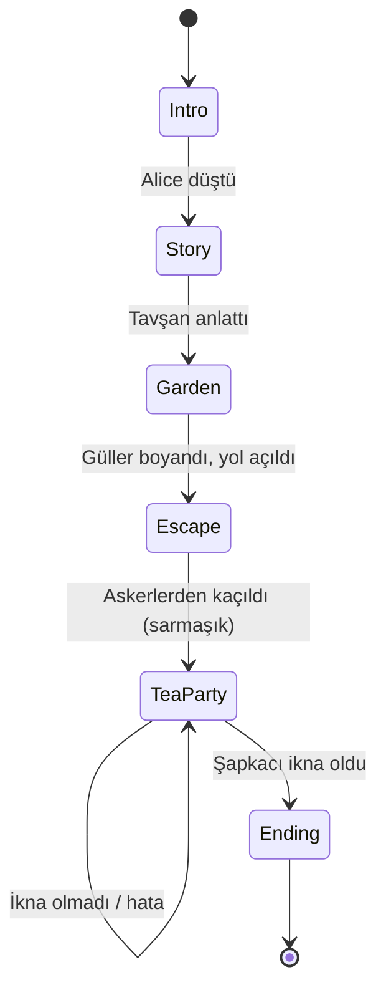
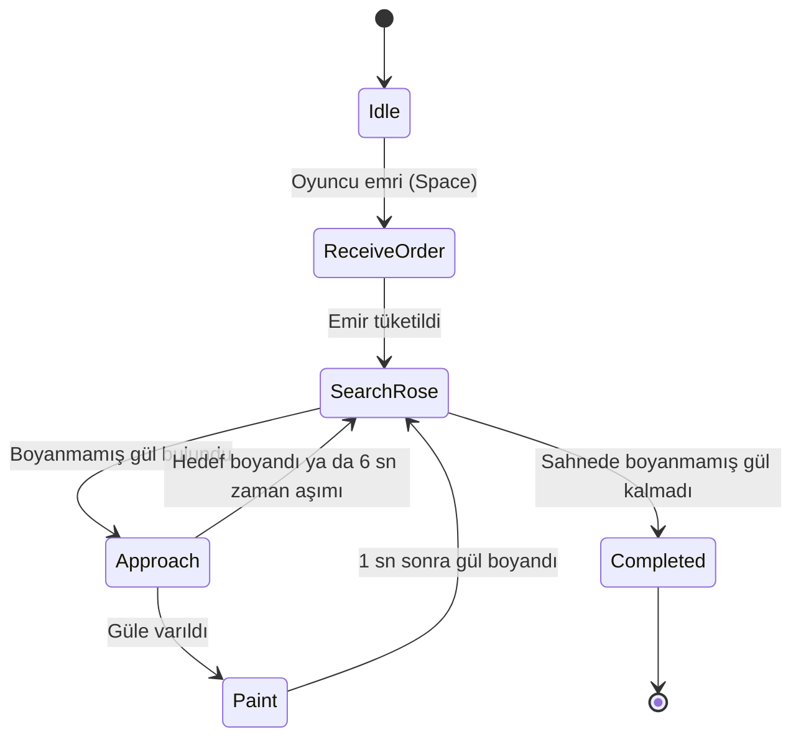
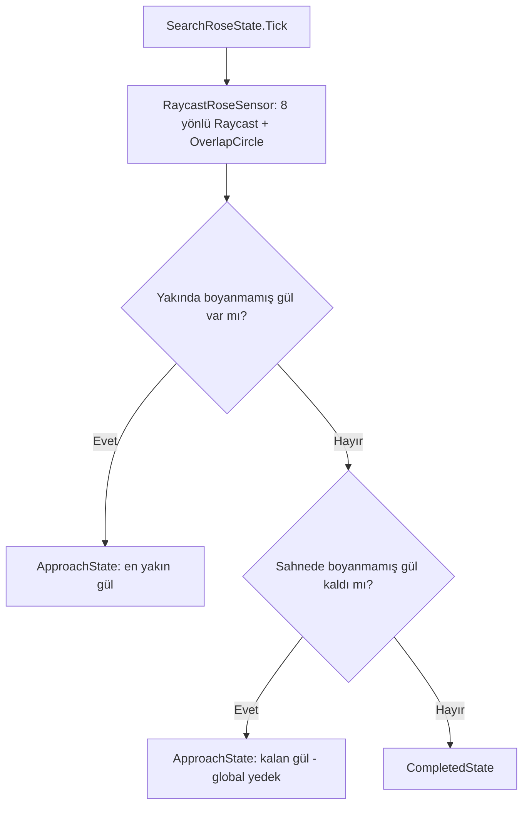
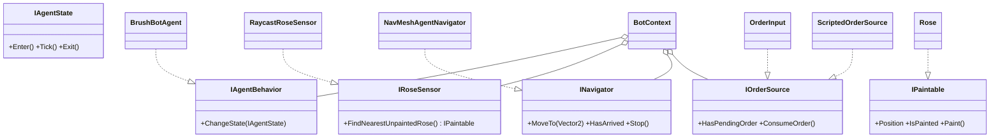

# Alice Burada Her Şey Ters

**Kocaeli Üniversitesi · Teknoloji Fakültesi · Bilişim Sistemleri Mühendisliği**
**Yazılım Geliştirme Laboratuvarı-I · Proje-1**

| Ekip üyesi | Öğrenci no | Hat |
|---|---|---|
| Gamze Ayar | 241307033 | Otonom ajan (Kişi A) |
| Kevser Yücedağ | 241307062 | Yerel LLM (Kişi B) |

**Tarih:** Ekim 2026 · **Motor:** Unity 6.3 LTS (6000.3.26f1), C# · **Teslim:** 6 Kasım 2026

> Not: Git geçmişinde "gamze ayar" ve "gammzze" adlarıyla görünen commit'ler aynı kişiye (Gamze Ayar) aittir; farklı git kullanıcı adlarından kaynaklanır.

---

## 1. Giriş

### 1.1 Problem ve amaç

Proje, modern oyun geliştirmeye yapay zekâ entegrasyonunu konu alır. Tek bir Unity macera oyununda iki **birbirinden bağımsız** yapay zekâ bileşeni uçtan uca geliştirilmiştir:

1. **Otonom kahraman (Fırça Bot):** NavMesh tabanlı yol bulma ve durum makinesiyle çalışan, oyuncunun emriyle fiziksel engeli aşan yardımcı ajan.
2. **Yerel LLM destekli NPC (Çılgın Şapkacı):** Ollama üzerinde çalışan yerel bir dil modeliyle oyuncuyla serbest metinle konuşan, yapılandırılmış (JSON) çıktısı oyun durumuna bağlanan NPC.

Tüm sistem OOP/SOLID ilkelerine (arayüzler, soyutlama, tek sorumluluk) göre tasarlanmıştır. LLM tamamen yereldir, bulut API kullanılmaz.

### 1.2 Oyun senaryosu

Alice tavşan deliğinden düşer. Gül bahçesinde kendi başına aşamadığı bir engelle karşılaşır: dikenli beyaz güller yolu kapatmaktadır. Oyuncu emir verir, Fırça Bot güller boyanana kadar bulur, yaklaşır ve boyar; yol açılır. Ardından İskambil Askerlerinden kaçış bölümü gelir. Sarmaşıkla çay partisine geçilir ve burada Çılgın Şapkacı'yı serbest metinle ikna etmek gerekir. Şapkacı ikna olunca oyun biter.

| Kısım | Sahne | İçerik | Sahip |
|---|---|---|---|
| 1 | 01_Fall | Düşüş, oyun başlar | B |
| 2 | 02_Story | Beyaz Tavşan hikâyeyi anlatır (sabit metin ara sahne, LLM NPC değildir) | B |
| 3 | 03_RoseGarden | **Fiziksel engel:** Fırça Bot gülleri boyar | A |
| 4 | 04_Escape | İskambil Askerlerinden kaçış (ek mekanik) | A |
| 5 | 05_TeaParty | **Mantıksal engel:** Şapkacı'yı ikna etme | B |
| 6 | 06_Ending | Oyun sonu | B |

Sahne geçişleri `GameStateManager` (`IGameFlow` arayüzü) üzerinden yapılır: `GameStage` enum'u, `CompleteStage()`, `EndGame()` ve `OnStageChanged` olayı.

> **Önemli ayrım:** Otonom kahraman = **Fırça Bot**. İskambil Askerleri ek mekaniktir ve companion'dan ayrı bir bileşendir.

---

## 2. Otonom Kahraman: Karar Mekanizması

### 2.1 Yaklaşım

Fırça Bot, **NavMesh (NavMeshPlus, 2D)** ile yol bulur ve bir **durum makinesi** ile karar verir. ML-Agents / pekiştirmeli öğrenme kullanılmamıştır. Hareket scriptli ya da hardcoded waypoint'lerle taklit edilmez; hedef her seferinde sensör çıktısına göre seçilir ve `NavMeshAgent` ile yürünür.

### 2.2 Durum makinesi

| Durum | Görev |
|---|---|
| `IdleState` | Emir bekler |
| `ReceiveOrderState` | Emri tüketir (`ConsumeOrder`), aramaya geçer |
| `SearchRoseState` | Sensörle en yakın boyanmamış gülü arar; bulamazsa sahnede kalan boyanmamış gül var mı global kontrol eder, yoksa tamamlanır |
| `ApproachState` | `INavigator.MoveTo` ile hedefe yürür; hedefe varış, hedefin başkasınca boyanması ve 6 sn zaman aşımı kontrol edilir |
| `PaintState` | Hareketi durdurur, 1 sn bekler, `Paint()` çağırır |
| `CompletedState` | Görevi bitirir |

### 2.3 Sensör akışı

Ajan çevresini `IRoseSensor` arayüzü üzerinden algılar. Somut sınıf `RaycastRoseSensor`, 8 yönlü `Physics2D.Raycast` ve `OverlapCircle` kullanır; güller ayrı bir layer'dadır.

> **Dürüstlük notu:** Sensör yerelde gül göremezse bot, sahnede kalan boyanmamış gülü global olarak bulur (sensör + global yedek). Bu, erken bitişe karşı bir dayanıklılık önlemidir.

### 2.4 OOP tasarımı

- Durumlar yalnızca arayüzleri bilir; emrin klavyeden mi testten mi geldiğini bilmez.
- Somut sınıflar yalnızca `BrushBotBootstrap` içinde birleştirilir.
- Test için `OrderInput` (klavye) yerine `ScriptedOrderSource` verilir; **bot kodu değişmeden** otomatik test yapılır.

### 2.5 Ek mekanik: İskambil Askerleri (04_Escape)

Askerler (`SoldierAI`, `FieldOfView2D`) devriye, fark etme, kovalama ve arama durumlarına sahiptir. Oyuncu yakalanırsa `CheckpointRespawn` ile oyun bitmeden yeniden doğar. Sarmaşığa ulaşınca `CompleteStage(Escape)` çağrılır. Askerler companion'dan bağımsız ek mekaniktir.

---

## 3. LLM Entegrasyonu (Kişi B)

> TODO (Kevser): sistem promptu, istek/yanıt akışı, JSON şeması (`reply`, `mood`, `persuasion`, `action`), sequence diyagramı (Mermaid), eylemin oyun durumuna bağlanması, model seçimi gerekçesi.

## 4. Hata Yönetimi Stratejisi (Kişi B)

> TODO (Kevser): Ollama kapalı, model yok, timeout, bozuk JSON, boş yanıt senaryoları ve davranışları. Ollama kapalıyken alınan ekran görüntüsü: `Isınma isteği başarısız (oyun etkilenmez)`.

---

## 5. Testler ve Sonuçlar

### 5.1 Otonom ajan testi (Kişi A)

#### Yöntem

`AgentTestRunner` (`Assets/Scripts/Companion/Testing/`), ayrı bir test sahnesinde (`99_AgentTest`, build'e dahil değil) botu defalarca çalıştırır.

- Her denemede 1-5 gül prefab'dan üretilir, bot `NavAgent.Warp` ile başlangıç noktasına alınır.
- Emir `ScriptedOrderSource` ile otomatik verilir.
- **Başarı:** tüm güllerin `IsPainted == true` olması. **Zaman aşımı:** 60 sn.
- **Süre:** oyun zamanıdır (Time Scale 3), 1 sn'lik boyama süresi dahildir.
- **Tekrarlanabilirlik:** rastgele tohum 12345.
- **Runner takılma tanımı:** `ApproachState` sırasında 2 sn boyunca 0,05 birimden az yer değiştirme.
- Çıktı: CSV (`docs/results/`).

#### Sonuçlar

| Koşu | Koşul | Deneme | Başarı | Başarı oranı | Ort. süre (sn) |
|---|---|---|---|---|---|
| 1 | NavMesh üzerinde rastgele başlangıç | 50 | 50 | %100 | 12,34 |
| 2 | Sabit noktalar: (-4,-4), (0,0), (4,4) | 60 | 60 | %100 | 11,82 |
| 3 | Duvar yanı noktaları | 60 | 60 | %100 | 12,18 |
| **Toplam** | | **170** | **170** | **%100** | |

**Koşu 2, nokta bazında**

| Başlangıç | Konum | Deneme | Başarı | Ort. süre (sn) |
|---|---|---|---|---|
| Sabit-1 | (-4, -4) | 20 | 20 | 14,21 |
| Sabit-2 | (0, 0) | 20 | 20 | 11,73 |
| Sabit-3 | (4, 4) | 20 | 20 | 9,52 |

**Koşu 3 (duvar yanı), nokta bazında**

| Başlangıç | Konum | Deneme | Başarı | Ort. süre (sn) |
|---|---|---|---|---|
| Duvar-1 | (-1,39, -4,55) | 20 | 20 | 12,97 |
| Duvar-2 | (-7,90, -1,04) | 20 | 20 | 12,31 |
| Duvar-3 | (-3,47, 4,20) | 20 | 20 | 11,25 |

Ham veriler: `docs/results/*.csv`.

#### Yorum

- Süre, başlangıç konumundan çok gül sayısıyla orantılıdır (yaklaşık 4-5 sn/gül).
- Duvara yakın başlangıçlarda başarı ve süre belirgin değişmemiştir.

#### Sınırlılıklar

- Runner'ın takılma ölçümü 0 çıkmıştır; ancak `ApproachState`'in 6 sn zaman aşımı mekanizması testler sırasında birkaç kez devreye girmiştir (bot hedefe 6 sn içinde ulaşamayıp gülü atlamış, yeniden aramış ve görev yine tamamlanmıştır). Bu olaylar CSV'ye sayılmamıştır, kesin sayısı ölçülmemiştir.
- Duvar yanı mesafeleri (~0,4 birim) sprite boyutunun 1 birim olduğu varsayımıyla hesaplanmış yaklaşık değerlerdir.
- Başarı oranı yalnızca test sahnesinin geometrisi için geçerlidir.
- Sensör yerelde gül göremezse global yedek devreye girer.

**Olası geliştirme:** `BotContext`'e gerçek bir `StuckCount` sayacı eklemek ve CSV'ye yazmak.

#### Ekran görüntüleri

> TODO: `docs/images/` altına eklenecek (bahçede bot, 04_Escape, test Console çıktısı, `[Flow]` zinciri, build sahne listesi, PR geçmişi).

### 5.2 NPC diyalog testleri (Kişi B)

> TODO (Kevser): en az 5 senaryo (ikna eden, kızdıran, alakasız, prompt injection, boş mesaj) ve modelin tepkileri.

---

## 6. Sonuç ve Tartışma

> TODO (ortak): başarılar, sınırlılıklar, olası geliştirmeler.
> A tarafı taslağı: gerçek NavMesh ajanı ve 170 denemelik tekrarlanabilir test; OOP/arayüz tabanlı test edilebilirlik; sahne akışı hataları (static `Instance`, yerel yönetici kopyası) log ile bulunup çözüldü. Geliştirme: gerçek `StuckCount`, Input System'e geçiş, ML-Agents.

---

## Ek A: Asset ve lisans listesi

> TODO: görsel kararı sonrası doldurulacak.

| Asset | Kaynak | Lisans | Kullanım |
|---|---|---|---|
| | | | |

## Ek B: Model seçimi gerekçesi (Kişi B)

> TODO (Kevser): model, donanım kapasitesi.

## Ek C: Çalıştırma

1. Unity 6.3 LTS (6000.3.26f1) ile projeyi aç.
2. Ollama'yı başlat ve modeli yükle (`ollama list`).
3. Sahne sırası: 00_MainMenu → 01 → 02 → 03 → 04 → 05 → 06.
4. Ajan testi: `Assets/Scenes/Testing/99_AgentTest` sahnesini aç, Play.